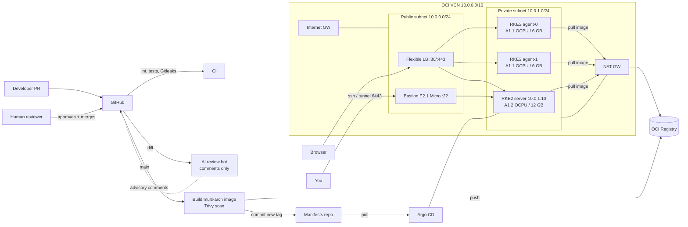

# Delivery Platform Architecture (OCI Always Free + RKE2 + GitOps)

## Network design: why each piece exists

| Piece | CIDR / value | Why |
|---|---|---|
| VCN | `10.0.0.0/16` | 65k addresses means new subnets (for example a database tier) can be added later without re-addressing. It doesn't overlap RKE2's pod network (`10.42.0.0/16`) or service network (`10.43.0.0/16`), so a packet's destination is never ambiguous. |
| Public subnet | `10.0.0.0/24` | Holds only what has to be reachable from the internet: the load balancer and the bastion. Its default route goes to the **Internet Gateway**. |
| Private subnet | `10.0.1.0/24`, `prohibit_public_ip_on_vnic` | Holds the Kubernetes nodes. They can't get a public IP even by mistake. Its default route goes to the **NAT Gateway**, so nodes can make outbound connections (image pulls, apt, Hugging Face) but nothing can start a connection to them from outside. |
| RKE2 server IP | `10.0.1.10` (fixed) | Agents join at `https://10.0.1.10:9345`. A fixed IP means cloud-init needs no service discovery. |
| DNS labels | `ragvcn` / `pub` / `priv` | VCN DNS resolves names such as `rke2-server.priv.ragvcn.oraclevcn.com`. Public DNS for the app uses `nip.io`, which is free wildcard DNS for the LB IP. Swap in an OCI DNS zone once you own a domain. |
| Security lists | egress only | Kept minimal on purpose. All ingress rules live in **NSGs**, which attach to individual VNICs rather than whole subnets and can reference other NSGs instead of CIDRs. |

### NSG rules

| NSG | Direction | Source/Dest | Ports | Why |
|---|---|---|---|---|
| bastion | in | `admin_cidr` (your /32) | 22 | Only you can SSH in. |
| lb | in | 0.0.0.0/0 | 80, 443 | The only public entry point for app traffic. |
| lb | out | nsg-nodes | tcp | The LB forwards to ingress-nginx on the nodes. |
| nodes | in | nsg-nodes | all | Node-to-node traffic: 9345 (RKE2 supervisor), 6443 (API server), 10250 (kubelet), 2379-2380 (etcd), 8472/udp (Canal VXLAN). |
| nodes | in | nsg-bastion | 22, 6443 | Admin SSH and `kubectl` go through the bastion only. |
| nodes | in | nsg-lb | 80, 443 | ingress-nginx host ports accept traffic from the LB only. |

Inside the cluster, the `rag` namespace has a **default-deny ingress NetworkPolicy**. The only allowed traffic is from `rke2-ingress-nginx` to the app on port 8501.

## Compute (all Always Free)

| VM | Shape | Size | Role |
|---|---|---|---|
| bastion | VM.Standard.E2.1.Micro (x86) | 1/8 OCPU, 1 GB | Jump host |
| rke2-server | VM.Standard.A1.Flex (ARM) | 2 OCPU, 12 GB | Control plane, etcd, and schedulable |
| rke2-agent-0/1 | VM.Standard.A1.Flex (ARM) | 1 OCPU, 6 GB each | Workers |

The three A1 VMs use exactly the free A1 allowance of 4 OCPU and 24 GB. The image has to be **multi-arch** because the nodes are ARM.

## Workload

- **Deployment.** Rolling update with `maxUnavailable: 0`. A startupProbe allows 5 minutes for the cold start (corpus and embedding-model download) before liveness checks begin. Readiness and liveness use `/_stcore/health`. Requests are 250m CPU / 1.5 Gi, limits are 1 CPU / 2.5 Gi. The container runs as a non-root user and drops all capabilities.
- **HPA.** Scales from 1 to 3 replicas at 70% CPU, with a 5-minute scale-down stabilization window. Ingress uses **cookie affinity** because each Streamlit session holds a websocket to one pod.
- **PDB** with `maxUnavailable: 1`, plus topology spread across nodes.
- **Secrets.** `GROQ_API_KEY` lives in the `rag-app-secrets` Secret (key `secrets.toml`), which is mounted where `st.secrets` reads it. It is never stored in git.

## Delivery

1. A PR runs CI (ruff, pytest, requirements check, Gitleaks), the container workflow (build, then Trivy), and the AI review, which only posts comments.
2. Branch protection requires CI to pass **and one human approval**. The AI can't approve.
3. A merge to `master` builds a multi-arch image tagged `sha-<7>` and pushes it to OCIR. CI then commits the new tag to the manifests repo.
4. Argo CD (with auto-sync, prune, and self-heal) applies the change. To roll back, `git revert` the bump commit.

## What I'd do differently in production

- Use **3 server nodes** for etcd quorum. One server is a single point of failure for the control plane, though running workloads survive its loss.
- Use **OCI Bastion service** or a VPN instead of a VM bastion, and short-lived SSH certificates.
- Use **External Secrets + OCI Vault** instead of a manually created Secret, and **cert-manager** with real TLS on a real domain.
- Use the **OCI Cloud Controller Manager** so `Service type=LoadBalancer` manages the LB instead of Terraform.
- Store **remote Terraform state** in OCI Object Storage with locking, and run `terraform plan` on PRs.
- Use **image signing** (cosign) with admission verification, and pin base images by digest.
- Add observability: Prometheus, Grafana, and alerts on probe failures and HPA saturation.
